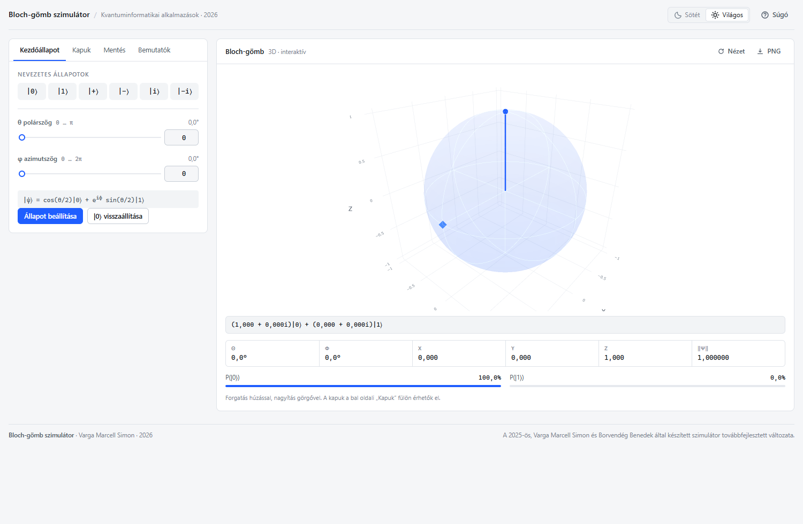
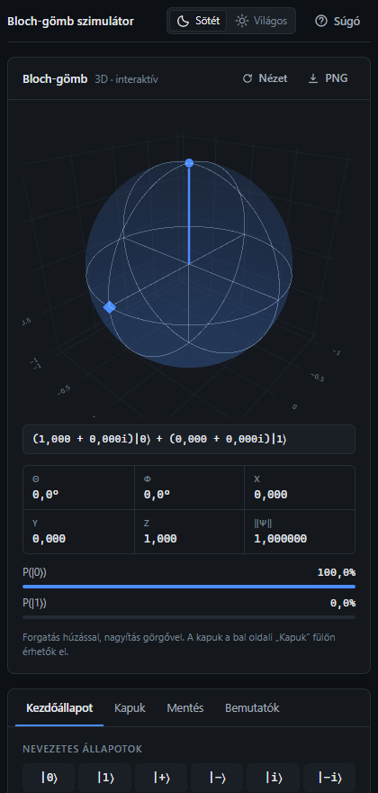

# Bloch-gömb szimulátor

**Kvantuminformatikai alkalmazások – 2. feladat (2026 ősz)**

Készítette: **Varga Marcell Simon**

Beadási határidő: 2026. november 15.

---

## 1. Bevezetés és a projekt eredete

A program egy interaktív, böngészőben futó **Bloch-gömb szimulátor**, amely egyetlen qubit
állapotának szemléltetésére szolgál. A felhasználó tetszőleges kezdőállapotot állíthat be,
kvantumkapukat fűzhet egymás után, és valós időben követheti, hogyan mozog az állapotvektor
a Bloch-gömbön. A program emellett több állapotot is képes egyszerre megjeleníteni
(pillanatképek és nyomvonal formájában), és beépített önteszttel igazolja a számítások
helyességét.

### 1.1. Transzparencia: a projekt előzménye

Ez a beadandó **nem nulláról indult**. A szimulátor első változatát 2025 őszén
**Varga Marcell Simon és Borvendég Benedek** készítette ugyanerre a kurzusra, és arra az
ötfokozatú értékelés szerint **jeles (5) érdemjegyet** kapott. A 2026-os beadás ennek a
programnak a **továbbfejlesztett változata**; a szerző ezúttal kizárólag Varga Marcell Simon,
mivel a korábbi társzerző a tárgyat már teljesítette.

A korábbi munka tiszteletben tartása érdekében:

- a 2025-ös dokumentáció változatlan formában megtalálható a forráskód melletti
  `elozmeny/` mappában (Word és PDF formátumban);
- a 2026-os program a korábbi felépítésre épül (Blazor WebAssembly + Plotly.js), de a
  felületet és a funkciókat jelentősen átdolgoztuk;
- az alkalmazás láblécében és a súgóban is szerepel az eredeti szerzőpáros neve.

### 1.2. Mi változott a 2025-ös változathoz képest?

| Terület | 2025-ös változat | 2026-os változat |
|---|---|---|
| Felület | világos, kártyás elrendezés | modern, sötét/világos téma, reszponzív |
| Kapuk | I, X, Y, Z, H, S, T, Rx, Ry, Rz | ugyanaz + szövegbevitel, paletta-leírások, mátrixok |
| Végrehajtás | kapusor, lépésenként | + végrehajtott kapuk előzménye, visszavonás inverz mátrixszal |
| Megjelenítés | állapotvektor + pillanatképek | + animált mozgás, bejárt nyomvonal, főkörök, tengelyek |
| Visszajelzés | állapotvektor, koordináták | + θ/φ, mérési valószínűségek, norma, mérés szimuláció |
| Helyesség igazolása | kézi tesztelés | + beépített önteszt (19 ellenőrzés) egy kattintással |
| Futtatás | webszerver szükséges | saját webhely + telepítés nélküli Windows indító |
| Dokumentáció | 6 oldal | jelen dokumentum, követelmény-megfelelési táblázattal |

---

## 2. Megfelelés a 2026-os feladatkiírásnak

### 2.1. Beadandó elemek

| Előírás | Megvalósítás |
|---|---|
| A szimulátor kódja | `BlochGomb/` mappa (C# forrás, Razor komponensek, JS) |
| Futtatható szimulátor, telepítés nélkül, böngészős Windows gépen | `docs/` mappa: az `Inditas.bat` elindítja, illetve saját webhelyen is elérhető |
| Legalább 3 oldalas dokumentáció | ez a dokumentum (nyomtatásban 7–8 oldal) |

### 2.2. A program értékelési szempontjai (2. szempont)

| Szempont | Megvalósítás |
|---|---|
| Mennyi és milyen kapu érhető el? | **10 kapu**: Pauli-kapuk (I, X, Y, Z), speciális kapuk (H, S, T), forgatási kapuk (Rx, Ry, Rz) tetszőleges szöggel |
| Ezek helyesen működnek? | a beépített önteszt **19/19** ellenőrzése sikeres; az automatikus böngészős teszt is hibátlan |
| Van-e lehetőség a kapuk egymásba fűzésére? | áramkör-építő sáv, lépésenkénti és teljes végrehajtás, végrehajtott kapuk listája, visszavonás |
| Tud több állapotot egyszerre mutatni? | korlátlan számú **pillanatkép** (címke + szín) és a bejárt út **nyomvonala** egyszerre látszik |
| Tetszőleges kezdőállapot megadható? | θ és φ csúszkával/számmal, valamint 6 nevezetes állapot gyorsgombbal |

A felhasználói élményt (3. szempont) a témázható felület, az animációk, a súgó, a
billentyűparancsok és a mobilon is használható elrendezés szolgálja.

---

## 3. Funkciók

### 3.1. Kezdőállapot beállítása

- **6 nevezetes állapot** egy kattintással: \|0⟩, \|1⟩, \|+⟩, \|−⟩, \|i⟩, \|−i⟩.
- **Tetszőleges állapot** a θ (0…π) és φ (0…2π) szögekkel; a csúszka és a számmező
  szinkronban van, a szög fokban is látszik.
- Az állapot matematikai alakja folyamatosan megjelenik:
  `|ψ⟩ = (a+bi)|0⟩ + (c+di)|1⟩`.

### 3.2. Kapuk és áramkör

- **10 kapu**: I, X, Y, Z (Pauli), H (Hadamard), S, T (fázis), Rx(θ), Ry(θ), Rz(θ)
  (forgatás). A palettán minden kapu esetén tooltip mutatja a leírást és a mátrixot.
- A forgatási szög **fokban** adható meg (−360°…360°), a program radiánban számol.
- A kapuk a **sorra illesztés** után „Áramkör” sávban jelennek meg; egyenként is
  törölhetők.
- **Léptetés** (egy kapu) és **Végrehajtás** (az összes hátralévő kapu).
- A már végrehajtott kapuk **előzménye** külön sorban látszik (pl. H → Z → H).
- **Visszavonás**: ha van függő kapu, azt törli; ha nincs, az utolsó végrehajtott kaput
  vonja vissza az **inverz (adjungált) mátrixszal**, így az állapot pontosan visszaáll.

### 3.3. Megjelenítés

- **Interaktív 3D Bloch-gömb** (Plotly.js): forgatás egérrel, nagyítás görgővel.
- A gömbön látszik a **három tengely** és a **három főkör**, ami segíti a tájékozódást.
- Az állapotvektor mozgása **animált**, a bejárt út **nyomvonalként** marad meg.
- **Pillanatképek**: tetszőleges számú állapot menthető címkével és színnel; ezek
  gyémánt jelölőként jelennek meg, így a kezdő-, köztes- és végállapot egyszerre látszik.
- Élő adatok: θ, φ, x, y, z koordináták, az állapotvektor normája, valamint
  **P(\|0⟩)** és **P(\|1⟩)** valószínűségek oszlopdiagramon.

### 3.4. Oktatási segédeszközök

- **Bemutatók**: öt előre elkészített áramkör egy kattintással (szuperpozíció,
  H→Z→H = X azonosság, Rx(90°), fázisforgatás, mérés szuperpozícióban).
- **Mérés szimulációja**: a Z-bázisban mért eredmény és a hullámfüggvény összeomlása.
- **Beépített önteszt**: 19 ismert kvantummechanikai azonosság ellenőrzése
  (pl. H\|0⟩ = \|+⟩, S² = Z, HZH = X, Rx(π)\|0⟩ = \|1⟩, normamegmaradás).
- **Súgó** a képletekkel és a billentyűparancsokkal.
- **PNG export** a gömb aktuális nézetéről, valamint nézet-visszaállítás.

### 3.5. Felület

A felület tudatosan **mérnöki eszköz**, nem bemutatóoldal: a vezérlők négy fülön
(Kezdőállapot / Kapuk / Mentés / Bemutatók) érhetők el, a Bloch-gömb és az élő adatok
pedig folyamatosan láthatók a jobb oldalon.

- **Egy akcentszín + neutrális szürkeskála**, keret-alapú rétegzés árnyékok helyett,
  4/8/12/16 px-es térköz-skála, 12–14 px-es produktív tipográfia, sematikus
  vonalikonok – nincs emoji, nincs színátmenet. (Az elvek az IBM Carbon design
  rendszer nyilvános irányelveit követik.)
- **Sötét és világos téma** (a választás a böngészőben megjegyződik).
- **Reszponzív elrendezés**: asztali gépen két hasáb, mobilon egy hasáb (a gömb felül).
- A gömb alatt mindig látszik az **állapotvektor** matematikai alakja, a θ/φ szögek,
  az x, y, z koordináták, a norma és a két mérési valószínűség.
- **Billentyűparancsok**: `I` `X` `Y` `Z` `H` `S` `T` (kapu hozzáadása),
  `Enter` (léptetés), `Backspace` (visszavonás).
- Minden fájl **helyben** van (nincs CDN), így a program internet nélkül is működik.


---

## 4. Telepítés és futtatás

A program futtatásához **nem kell fejlesztőkörnyezetet telepíteni**: elég egy böngésző.

### 4.1. Saját webhely (ajánlott)

A szimulátor a `docs/` mappa GitHub Pages-re történő feltöltésével publikálható.
A webcím a feltöltés után: `https://<felhasználónév>.github.io/<repó-neve>/`.

A publikálás lépései:

1. Hozz létre egy új repót a GitHubon (pl. `bloch-gomb`).
2. Töltsd fel a `Bloch-gomb-2026` mappa tartalmát.
3. A repóban: *Settings → Pages → Source: Deploy from a branch*, branch: `main`,
   mappa: `/docs`, majd *Save*.
4. Egy percen belül megjelenik a webcím.

> A `docs/index.html` relatív báziscímet (`<base href="./" />`) használ, ezért a
> projekt-oldal (repo mappa) és a felhasználói oldal alatt is egyaránt működik.

### 4.2. Helyi futtatás Windows-on, telepítés nélkül

1. Csomagold ki a `docs/` mappa tartalmát (vagy a teljes beadott csomagot).
2. Kattints dupla kattintással az **`Inditas.bat`** fájlra.
3. Megnyílik egy konzolablak (a helyi webszerver) és a böngésző:
   `http://localhost:8765/`.
4. A szimulátor bezárásához a konzolablakot kell bezárni.

Az indító csak a Windowsba épített PowerShellt használja, semmit nem telepít.
**Fontos:** az `index.html` dupla kattintással *nem* indul el, mert a böngészők
biztonsági okból tiltják a WebAssembly-modulok betöltését `file://` címről.

### 4.3. Futtatás fejlesztőként

.NET 8 SDK-val a forrásmappában:

```
dotnet run --project BlochGomb\BlochSimulator.csproj
```

Újrapublikálás (a `docs/` mappa frissítése):

```
powershell -ExecutionPolicy Bypass -File tools\publish.ps1 -OutDir docs
```

Visual Studio 2022 esetén a `BlochGomb2026.sln` megnyitása és az `F5` is elegendő.

### 4.4. Első lépések (1 perc)

1. Válassz kezdőállapotot (pl. \|0⟩), majd „Állapot beállítása”.
2. Kattints a **H** kapura, majd a „Végrehajtás” gombra – az állapot a \|+⟩ lesz.
3. Nyomd meg a „Mentés” gombot a pillanatképeknél: az állapot megjelenik a gömbön.
4. Alkalmazz egy **Z** kaput, majd egy újabb **H**-t: az eredmény \|1⟩ (HZH = X).
5. Nyomd meg az „Önteszt” gombot: 19/19 zöld pipa.



---

## 5. Felhasznált technológiák és könyvtárak

| Komponens | Technológia / könyvtár | Verzió | Szerep |
|---|---|---|---|
| Keretrendszer | Blazor WebAssembly (.NET) | 8.0 | C# kód futtatása a böngészőben, szerver nélkül |
| Nyelv | C# | 12 | állapotszámítás, mátrixműveletek (`System.Numerics`) |
| Modellezés | `System.Numerics.Complex` | .NET 8 | komplex amplitúdók, unitér mátrixok |
| Vizualizáció | Plotly.js | 3.2.0 (helyi) | interaktív 3D felület, WebGL |
| Megjelenés | HTML5 + CSS3 (saját) | – | reszponzív elrendezés, témák, animációk |
| Helyi futtatás | PowerShell + .NET (saját MiniHttpServer) | Windows 10/11 | webszerver telepítés nélkül |
| Fejlesztéshez | .NET SDK | 8.0.426 | build és publish |

Külső CDN-t a program **nem** használ: a Plotly.js a `wwwroot/js/plotly.min.js`
fájlban található, így az alkalmazás internetkapcsolat nélkül is betölt.

---

## 6. Matematikai háttér

### 6.1. A qubit állapota

Egy qubit tiszta állapota:

|ψ⟩ = α\|0⟩ + β\|1⟩, ahol α, β ∈ ℂ és \|α\|² + \|β\|² = 1.

A bázisvektorok: \|0⟩ = (1, 0)ᵀ és \|1⟩ = (0, 1)ᵀ.

### 6.2. Bloch-reprezentáció

A globális fázis nem figyelhető meg, ezért a két komplex amplitúdó helyett két valós
szög írja le az állapotot:

|ψ⟩ = cos(θ/2)\|0⟩ + e^(iφ)·sin(θ/2)\|1⟩, ahol θ ∈ [0, π], φ ∈ [0, 2π).

A Bloch-gömb koordinátái (a programban is ezek a képletek szerepelnek):

| Koordináta | Képlet |
|---|---|
| x | 2·Re(αβ*) = sin θ·cos φ |
| y | −2·Im(αβ*) = sin θ·sin φ |
| z | \|α\|² − \|β\|² = cos θ |

A nevezetes állapotok helye:

| Állapot | Pozíció | Koordináták |
|---|---|---|
| \|0⟩ | északi pólus | (0, 0, 1) |
| \|1⟩ | déli pólus | (0, 0, −1) |
| \|+⟩ | +X tengely | (1, 0, 0) |
| \|−⟩ | −X tengely | (−1, 0, 0) |
| \|i⟩ | +Y tengely | (0, 1, 0) |
| \|−i⟩ | −Y tengely | (0, −1, 0) |

### 6.3. Kapuk

A kapuk 2×2-es unitér mátrixok (U†U = I), a hatásuk \|ψ'⟩ = U\|ψ⟩:

| Kapu | Mátrix | Jelentés |
|---|---|---|
| I | [1 0; 0 1] | identitás |
| X | [0 1; 1 0] | bit-flip, 180° az X körül |
| Y | [0 −i; i 0] | bit- és fázisflip, 180° az Y körül |
| Z | [1 0; 0 −1] | fázisflip, 180° a Z körül |
| H | 1/√2·[1 1; 1 −1] | Hadamard, szuperpozíció |
| S | [1 0; 0 i] | 90°-os fázisforgatás |
| T | [1 0; 0 e^(iπ/4)] | 45°-os fázisforgatás |
| Rx(θ) | [cos(θ/2) −i·sin(θ/2); −i·sin(θ/2) cos(θ/2)] | forgatás X körül |
| Ry(θ) | [cos(θ/2) −sin(θ/2); sin(θ/2) cos(θ/2)] | forgatás Y körül |
| Rz(θ) | diag(e^(−iθ/2), e^(iθ/2)) | forgatás Z körül |

### 6.4. Mérés és visszavonás

- **Mérés (Z-bázis)**: P(0) = \|α\|², P(1) = \|β\|²; a mérés után az állapot a mért
  bázisvektorra omlik össze.
- **Visszavonás**: mivel a kapuk unitérek, U⁻¹ = U†. A program az utolsó kaput az
  adjungált mátrixszal alkalmazza, így az állapot pontosan az előző lesz
  (pl. S⁻¹ = diag(1, −i), Rx(θ)⁻¹ = Rx(−θ)).

---

## 7. Architektúra

```
Bloch-gomb-2026/
├── BlochGomb/                      a program forráskódja
│   ├── Pages/Index.razor           felület + vezérlési logika (Blazor komponens)
│   ├── Services/QuantumService.cs   matematikai mag (állapot, kapuk, Bloch-vektor)
│   ├── Services/QuantumSelfTest.cs  beépített önteszt (19 ellenőrzés)
│   ├── wwwroot/index.html           belépési pont, helyi Plotly betöltése
│   ├── wwwroot/css/app.css           felület (témák, elrendezés, animációk)
│   └── wwwroot/js/bloch.js           Plotly-vezérlő (animáció, nyomvonal, PNG export)
├── docs/                            futtatható, publikálható változat (GitHub Pages)
├── tools/                           publikáló szkript és a helyi szerver indítója
├── elozmeny/                         a 2025-ös dokumentáció (előzmény)
└── Dokumentacio_2026.md             ennek a dokumentumnak a forrása
```

A felület és a matematika szétválik: a `QuantumService` nem tud a felületről, a
komponens pedig csak metódusokat hív. A 3D megjelenítést egy külön JavaScript modul
(`window.blochgomb`) végzi, amelyet a komponens JSON-adattal hív meg:

```
{ x, y, z, theme, animate, trail: [...], snapshots: [{ label, color, x, y, z }] }
```

A `blochgomb.update` teljes újrarajzolást (`Plotly.react`) végez, majd az állapotvektort
`requestAnimationFrame`-mel animálja; a nyomvonal utolsó pontja csak az animáció végén
jelenik meg, így a mozgás vizuálisan is helyes.

---

## 8. Tesztelés

### 8.1. Beépített önteszt

A program „Önteszt” gombja 19 ismert azonosságot ellenőriz (tolerancia 1e−6), és
eredményét a felületen is megjeleníti. Néhány példa:

| Ellenőrzés | Elvárt Bloch-vektor |
|---|---|
| X\|0⟩ = \|1⟩ | (0, 0, −1) |
| H\|0⟩ = \|+⟩ | (1, 0, 0) |
| Z\|+⟩ = \|−⟩ | (−1, 0, 0) |
| S\|+⟩ = \|i⟩ | (0, 1, 0) |
| S² = Z | (−1, 0, 0) |
| T² = S | (0, 1, 0) |
| Rx(π)\|0⟩ = \|1⟩ | (0, 0, −1) |
| Ry(π/2)\|0⟩ = \|+⟩ | (1, 0, 0) |
| HZH = X | (0, 0, −1) |
| visszavonás (H, S, undo, undo) | (0, 0, 1) |
| normamegmaradás 40 véletlen kapu után | ‖ψ‖ = 1,000000000000 |

Eredmény a fejlesztői gépen: **19 / 19 teszt sikeres**.

### 8.2. Automatikus böngészős teszt

A programot headless Chrome-mal (Playwright) is végigteszteltük. A mérés eredménye:

| Teszt | Eredmény |
|---|---|
| Betöltés, felület renderelése | ✓ |
| Kezdőállapot \|0⟩, θ = 0°, φ = 0° | ✓ |
| X kapu + végrehajtás → \|1⟩, vektor (0, 0, −1) | ✓ |
| Visszavonás → \|0⟩, vektor (0, 0, 1) | ✓ |
| H → Z → H demó → \|1⟩, előzmény: H Z H | ✓ |
| Visszavonás a demó után → \|−⟩, vektor (−1, 0, 0) | ✓ |
| Pillanatkép mentése és megjelenítése a gömbön | ✓ |
| Önteszt a felületről | 19/19 |
| Témaváltás, súgó, mobil nézet | ✓ |
| Konzolhiba / 404 | nincs |

### 8.3. Ismert korlátok

- A szimulátor **egy qubitre** vonatkozik (a Bloch-gömb csak tiszta állapotokat ábrázol).
- A mérés eredménye véletlenszerű; nincs lehetőség az eredmény előzetes rögzítésére.
- A `docs/` mappa ~18 MB, mert a .NET WebAssembly futtatókörnyezet is benne van.



---

## 9. Hibaelhárítás

| Tünet | Ok / megoldás |
|---|---|
| Az `index.html` dupla kattintásra üres marad | A böngésző `file://` címről nem tölti be a WebAssembly modulokat. Használd az `Inditas.bat`-ot, vagy töltsd fel a `docs/` mappát egy webhelyre. |
| Az `Inditas.bat` „HIBA: az index.html nem található” üzenetet ad | Az `Inditas.bat`, a `szerver.ps1`, a `MiniServer.cs` és az `index.html` ugyanabban a mappában legyen. |
| A 8765-ös port foglalt | Az indító automatikusan a következő szabad portra vált, és kiírja a címet. |
| A PowerShell „nem engedélyezett szkript” hibát jelez | Az `Inditas.bat` már `-ExecutionPolicy Bypass` kapcsolóval indítja a szkriptet. |
| A gömb üres, de a felület látszik | Ellenőrizd, hogy a `js/plotly.min.js` és a `js/bloch.js` betöltődött-e (F12 → Console). |
| A böngésző gyorsítótára régi verziót mutat | `Ctrl+F5`, illetve a szerver `Cache-Control: no-store` fejlécet küld. |
| A build nem indul | .NET 8 SDK szükséges: `dotnet --list-sdks`; a `tools/publish.ps1` megkeresi a helyi SDK-t is. |

---

## 10. Jövőbeli fejlesztések

- Kétqubites állapotok és kapuk (CNOT), összefonódott állapotok szemléltetése.
- Kvantumáramkör-diagram (kapuk idővonalon) és JSON-alapú import/export.
- Mérési statisztikák (több ezer lövés szimulációja hisztogrammal).
- Saját oktató mód: lépésenkénti magyarázatok, feladatok.
- Offline PWA (service worker), hogy a webhely internet nélkül is elérhető legyen.

---

## 11. Hivatkozások

1. Nielsen, M. A., & Chuang, I. L. (2010). *Quantum Computation and Quantum Information*.
   Cambridge University Press.
2. Plotly.js dokumentáció – https://plotly.com/javascript/
3. Microsoft Blazor dokumentáció – https://learn.microsoft.com/aspnet/core/blazor/
4. Qiskit Textbook – https://qiskit.org/textbook/
5. A 2025-ös változat dokumentációja (a `elozmeny/` mappában).

---

## 12. Nyilatkozat a mesterséges intelligencia használatáról

A 2026-os továbbfejlesztés során AI-asszisztens eszközt használtunk **támogató
jelleggel**: a felületi kód és a dokumentáció szövegezésének, strukturálásának
átnézéséhez, valamint a kódkommentek megfogalmazásához. A program logikáját,
a matematikai módszereket és a funkcionalitást a szerző határozta meg és ellenőrizte;
minden állítás a programmal és a beépített önteszttel ellenőrizhető. A program nem
tartalmaz AI által generált, nem ellenőrzött tartalmat.

---

## Függelék – fontos fájlok és parancsok

| Fájl / parancs | Leírás |
|---|---|
| `BlochGomb/Pages/Index.razor` | teljes felület és eseménykezelés |
| `BlochGomb/Services/QuantumService.cs` | állapot, kapuk, mérés, visszavonás |
| `BlochGomb/Services/QuantumSelfTest.cs` | 19 beépített teszt |
| `BlochGomb/wwwroot/js/bloch.js` | Plotly 3D vezérlő, animáció, export |
| `docs/` | kész, futtatható változat (webhely + indító) |
| `tools/publish.ps1` | build + publikálás a `docs/` mappába |
| `tools/szerver.ps1`, `tools/MiniServer.cs` | helyi webszerver Windows-ra |
| `dotnet build BlochGomb2026.sln -c Release` | fordítás |

