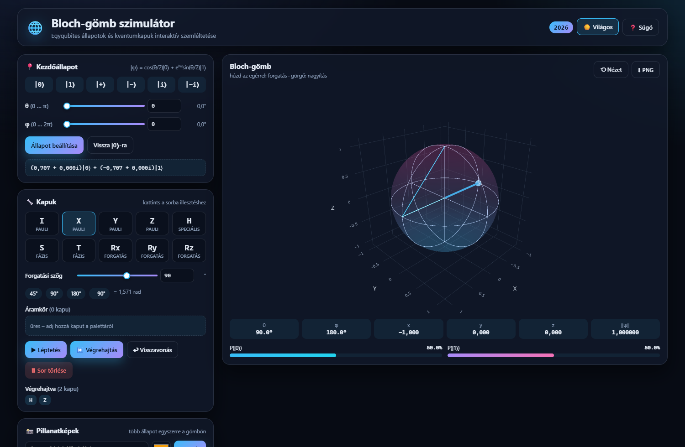

# Bloch-gömb szimulátor (2026)

Egyqubites kvantumállapotok és kvantumkapuk interaktív szemléltetése a böngészőben.
A program **Blazor WebAssembly** (C#) alapon fut, a 3D megjelenítést a **Plotly.js** végzi.



## Mit tud?

- **10 kvantumkapu**: I, X, Y, Z, H, S, T, Rx(θ), Ry(θ), Rz(θ)
- **Tetszőleges kezdőállapot** θ/φ szögekkel, illetve 6 nevezetes állapot gyorsgombbal
- **Áramkör-építés**: kapuk egymás után fűzése, léptetés, teljes végrehajtás
- **Visszavonás** az inverz (adjungált) mátrixszal
- **Több állapot egyszerre**: pillanatképek (címke + szín) és a bejárt út nyomvonala
- **Élő adatok**: θ, φ, x, y, z, norma, P(\|0⟩), P(\|1⟩)
- **Animált** állapotvektor, sötét/világos téma, reszponzív felület, billentyűparancsok
- **Beépített önteszt**: 19 kvantummechanikai azonosság ellenőrzése egy kattintással
- **Mérés** szimuláció (Z-bázis, hullámfüggvény-összeomlás)
- **Offline** működés: minden fájl helyben van, nincs CDN

## Futtatás

### 1. Weben (ajánlott)

A `docs/` mappa GitHub Pages-re tölthető, ekkor a program böngészőből érhető el:

```
https://<felhasználónév>.github.io/<repó-neve>/
```

### 2. Windows-on, telepítés nélkül

1. Nyisd meg a `docs/` mappát
2. Kattints dupla kattintással az **`Inditas.bat`** fájlra
3. A böngésző automatikusan megnyitja: `http://localhost:8765/`

> Az `index.html` közvetlen megnyitása (`file://`) nem működik, mert a böngészők
> biztonsági okból tiltják a WebAssembly modulok betöltését. Ezért kell a kis indító.

### 3. Fejlesztőként

```
dotnet run --project BlochGomb\BlochSimulator.csproj
```

Újrapublikálás a `docs/` mappába:

```
powershell -ExecutionPolicy Bypass -File tools\publish.ps1 -OutDir docs
```

## Felépítés

```
BlochGomb/               a program forráskódja (C#, Razor, CSS, JS)
  Pages/Index.razor      felület és vezérlés
  Services/              matematikai mag + önteszt
  wwwroot/               index.html, css, js (Plotly helyben)
docs/                    futtatható, publikálható változat (webhely + indító)
tools/                   publish.ps1, szerver.ps1, MiniHttpServer.cs, md2docx.py
elozmeny/                a 2025-ös dokumentáció (előzmény)
Dokumentacio_2026.md     a dokumentáció forrása
Dokumentáció_2026.docx   a beadható dokumentáció (Word)
```

## Előzmény és szerzők

A program a **2025-ben Varga Marcell Simon és Borvendég Benedek** által készített
Bloch-gömb szimulátor továbbfejlesztett változata (Kvantuminformatikai alkalmazások, BME).
A 2026-os változatot **Varga Marcell Simon** készítette; az eredeti dokumentációt a
`elozmeny/` mappa őrzi.

## Dokumentáció

- `Dokumentáció_2026.docx` – beadandó dokumentum (Word)
- `Dokumentacio_2026.md` – ugyanaz Markdown forrásban
- újragenerálás: `python tools/md2docx.py Dokumentacio_2026.md Dokumentáció_2026.docx`
